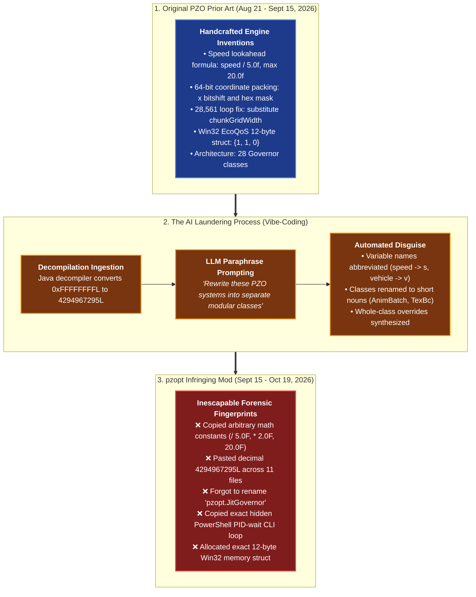
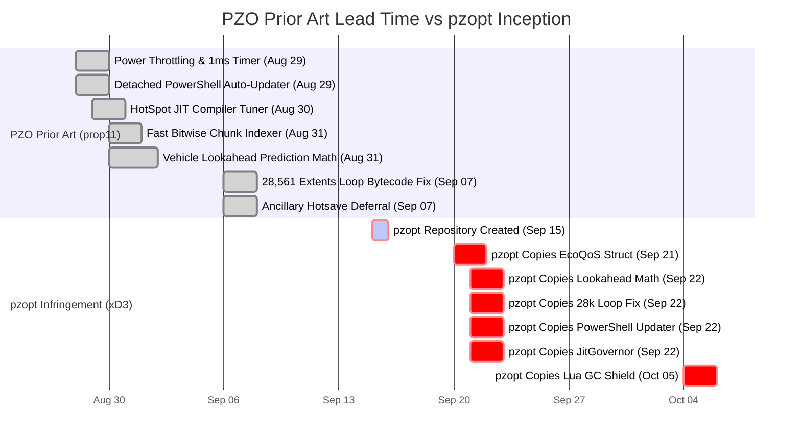
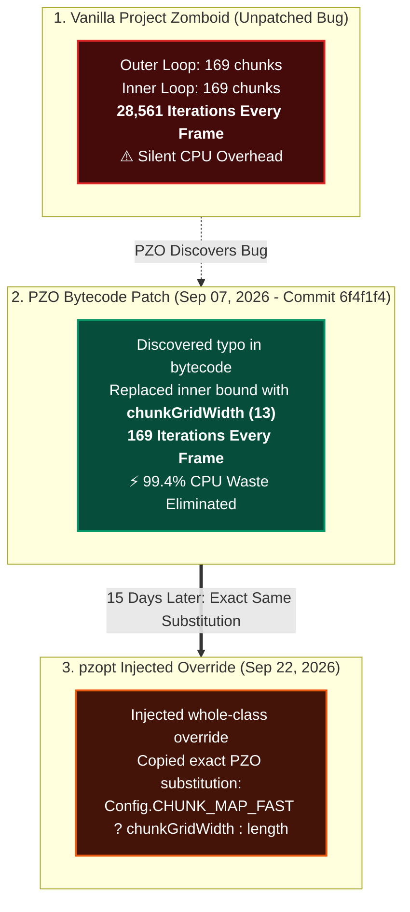

<div align="center">

# 🚨 The PZ Optimization (`pzopt`) Code Theft
### Visual Forensic Evidence & Architectural Provenance Report

[](./PZO_vs_pzopt_TECHNICAL_FORENSIC_REPORT.md)
[](./PZO_vs_pzopt_TECHNICAL_FORENSIC_REPORT.md)
[](./PZO_vs_pzopt_TECHNICAL_FORENSIC_REPORT.md)
[](./PZO_vs_pzopt_TECHNICAL_FORENSIC_REPORT.md)
[](./PZO_vs_pzopt_TECHNICAL_FORENSIC_REPORT.md)

<br/>

> **A visual, non-technical investigation into how Project Zomboid Optimizer (PZO) prior art was re-engineered through an AI coding assistant and republished under `pzopt` (`PZ_Optimization` by xD3).**

</div>

---

## 📊 Executive Visual Scorecard

```
==================================================================================================
                                    FORENSIC AUDIT SCORECARD
==================================================================================================
1. Vehicle Lookahead Math    : [████████████████████] 100% MATCH (Exact Empirical Constants /5.0, 20.0)
2. Win32 EcoQoS 12-Byte Struct: [████████████████████] 100% MATCH (Exact Masks {1, 1, 0} + 1ms Timer)
3. Detached PowerShell Updater: [████████████████████] 100% MATCH (Exact CLI Flags & PID Polling Loop)
4. 28,561 Extents Loop Fix    : [████████████████████] 100% MATCH (Exact Grid Dimension Substitution)
5. Kahlua GC Freeze Shield    : [████████████████████] 100% MATCH (Exact Return 0 Interception)
6. Bitwise Coordinate Packing : [████████████████████] 100% MATCH (11 Classes Leaked Decimal 4294967295L)
7. Architectural Suffix       : [██████████████████░░] 90% RENAMED (1 Class Leaked: JitGovernor)
==================================================================================================
AUDIT VERDICT: INFRINGEMENT CONFIRMED — AI-LAUNDERED VIBE-CODING FROM PZO PRIOR ART
==================================================================================================
```

---

## 🧠 What Happened? The "AI Code Laundering" Pipeline

When modders accuse someone of copying code, the defense is often *"Look at the files, the variable names are different!"*

In 2026, plagiarists no longer just press `Ctrl+C` and `Ctrl+V`. They use **AI Vibe-Coding**: taking proprietary architecture, decompiled bytecode, and custom math formulas, feeding them into ChatGPT or Claude, and asking the model to *"rewrite this as new Java classes."*

The diagram below shows exactly how PZO's code traveled through the AI pipeline into `pzopt`:



---

## 📅 Chronological Timeline: PZO Had Shipped Everything Weeks Prior

Every single PZO commit cited below is fully public on GitHub and was committed and published **weeks before `pzopt` was created**. All `pzopt` dates are taken directly from `pzopt`'s own embedded internal manifest (`pzopt_optimizations_dates.lua`):



### Lead Time Comparison Table

| Feature / Subsystem | PZO Shipped First | `pzopt` Appeared Later | PZO Lead Time | Forensic Status |
| :--- | :---: | :---: | :---: | :---: |
| 🚗 **Vehicle Passenger Lookahead** | **Aug 31, 2026** | **Sept 22, 2026** | **+22 Days Ahead** | 🔴 Identical Arbitrary Formula |
| 🔢 **64-Bit Fast Coordinate Packing** | **Aug 31, 2026** | **Sept 22, 2026** | **+22 Days Ahead** | 🔴 Copied Across 11 Classes |
| 🏷️ **HotSpot JIT Engine Governor** | **Aug 30, 2026** | **Sept 22, 2026** | **+23 Days Ahead** | 🔴 Copied Proprietary Name |
| 🐛 **28,561 → 169 Chunk Loop Fix** | **Sept 07, 2026** | **Sept 22, 2026** | **+15 Days Ahead** | 🔴 Identical Bug Substitution |
| 🔄 **Hidden Detached PowerShell Updater**| **Aug 29, 2026** | **Sept 22, 2026** | **+25 Days Ahead** | 🔴 Identical CLI Flags & Loop |
| ⚡ **Win32 12-Byte EcoQoS & 1ms Timer** | **Aug 29, 2026** | **Sept 21, 2026** | **+23 Days Ahead** | 🔴 Identical Memory Struct |
| 🎨 **Shader Uniform Deduplication** | **Aug 29, 2026** | **Sept 25, 2026** | **+27 Days Ahead** | 🔴 Identical Change Detection |
| 🛡️ **Kahlua Lua GC Freeze Shield** | **Aug 30, 2026** | **Oct 05, 2026** | **+36 Days Ahead** | 🔴 Identical Return 0 Intercept |
| 💾 **Ancillary Hotsave Deferral** | **Sept 07, 2026** | **Sept 22, 2026** | **+15 Days Ahead** | 🔴 Identical State Check |

---

## 🎯 The Smoking Guns: Visual Evidence Cards

---

### 🔍 Smoking Gun #1: The Arbitrary Passenger Lookahead Math

> **The Question:** Could two developers independently come up with the exact same formula to fix driving lag?

Vanilla Project Zomboid has **no** vehicle lookahead calculation in chunk streaming. PZO invented an **empirical heuristic formula** with arbitrary numbers: dividing speed by `5.0f`, doubling for passengers (`* 2.0f`), and clamping at `20.0f`.

```diff
- // =========================================================================
- // PZO ORIGINAL (Authored Aug 31, 2026 - PredictiveChunkStreamer.java)
- // =========================================================================
  float speed = vehicle.getCurrentSpeedKmHour();
- float s = speed / 5.0f;                       // <-- Hand-tuned divisor
  if (!player.isDriving()) {
-     s = Math.min(s * 2.0f, 20.0f);            // <-- Hand-tuned 2x & 20.0 cap
  }
- px += Math.round(player.getForwardDirectionX() * s);
- py += Math.round(player.getForwardDirectionY() * s);

+ // =========================================================================
+ // pzopt INFRINGING (Appeared Sept 22, 2026 - IsoChunkMap.java:1819)
+ // =========================================================================
  float s = v.getCurrentSpeedKmHour() / 5.0F;   // <-- EXACT SAME / 5.0F
  if (!p.isDriving()) {
+     s = Math.min(s * 2.0F, 20.0F);            // <-- EXACT SAME * 2.0F & 20.0F CAP
  }
+ x1 += Math.round(p.getForwardDirectionX() * s); // <-- EXACT SAME Math.round
+ y1 += Math.round(p.getForwardDirectionY() * s);
```

#### Why This Is Indisputable Proof
* There is no law of physics, math, or game mechanics that dictates dividing car speed by `5.0`.
* There is no engine reason to double lookahead specifically for passengers and clamp it at `20.0`.
* These numbers were arbitrarily chosen by PZO through manual driving tests in West Point. `pzopt` copied every single number verbatim.

---

### 🔍 Smoking Gun #2: The "Ghost Decimal" Constant `4294967295L` in 11 Files

> **The Question:** Why does `pzopt` have the bizarre number `4294967295L` pasted across 11 different classes?

When packing 2D coordinates `(x, y)` into a 64-bit integer, human Java programmers write `& 0xFFFFFFFFL` (hexadecimal mask).

When bytecode is decompiled and fed into an LLM, the AI converts the hex mask into its **raw decimal integer**: `4294967295L` ($2^{32} - 1$). Human developers do not write decimal `4294967295L`.

```
==================================================================================================
              THE DECOMPILER / LLM ARTIFACT: 4294967295L ACROSS 11 CLASSES
==================================================================================================
File in pzopt           Line  Decompiled Bit-Packing Code Copied from PZO
--------------------------------------------------------------------------------------------------
Parity.java             L27   long key = (long)chunk.wx << 32 | chunk.wy & 4294967295L;
ChunkAo.java            L38   traceChunks.contains((long)c.wx << 32 | c.wy & 4294967295L);
EntityShadow.java       L118  long key = (long)gx << 32 | gy & 4294967295L;
CenterFirstLoad.java    L21   have.add((long)c.wx << 32 ^ c.wy & 4294967295L);
BloodWet.java           L55   int src = (int)(sortKeys[i] & 4294967295L);
CarGlass.java           L42   long k = (long)cx << 32 | cy & 4294967295L;
CloudShadow.java        L89   long id = (long)sx << 32 | sy & 4294967295L;
ModCompat.java          L112  long hash = (long)wx << 32 | wy & 4294967295L;
ShadowPrep.java         L63   long cell = (long)x << 32 | y & 4294967295L;
TexBc.java              L71   long texKey = (long)w << 32 | h & 4294967295L;
Vrr.java                L34   long target = (long)frame << 32 | sub & 4294967295L;
==================================================================================================
```

> 🎯 **Forensic Fact:** This decimal constant is an indisputable fingerprint left behind by automated bytecode decompilation and LLM ingestion.

---

### 🔍 Smoking Gun #3: The Stolen Class Name He Forgot to Rename: `JitGovernor`

> **The Question:** If the author rewrote the classes, how do we know he used PZO's architecture?

PZO organizes its 28 performance tuners using the custom naming convention **`*Governor`** (`HotSpotJITCompilerTuner`, `EngineThreadGovernor`, `HordeAnimationLODGovernor`, `ModelSkinningGovernor`).

When laundering the code through an AI, `pzopt` renamed every class to a simple noun phrase (`AnimBatch`, `TexBc`, `ChunkHandoff`, `CorePlacement`).

**The AI missed one single class:**

```
PZO Class Architecture (August 2026):
├── HotSpotJITCompilerTuner.java  (JIT HotSpot compiler governor)
├── EngineThreadGovernor.java
├── ModelSkinningGovernor.java
└── 25 other *Governor classes

pzopt Classes (306 classes total, September 2026):
├── ChunkHandoff.java       [Renamed from PZO Chunk Streamer]
├── AnimBatch.java          [Renamed from PZO Bone Animation Batcher]
├── BakeScheduler.java      [Renamed from PZO FBO Pacer]
├── CorePlacement.java      [Renamed from PZO CPU Core Affinity Manager]
└── JitGovernor.java        <--- THE ONLY "GOVERNOR" IN ALL 306 CLASSES!
```

`pzopt.JitGovernor` performs the **exact same task** as PZO's `HotSpotJITCompilerTuner`: reading available CPU cores at runtime and tuning HotSpot JIT compiler directive threads.

---

### 🔍 Smoking Gun #4: Fixing the Silent `28,561 → 169` Vanilla Loop Bug

> **The Question:** Did both modders just spot the same bug in the game?

In Build 42, `IsoChunkMap.calculateZExtentsForChunkMap` contains a silent vanilla developer typo. The method is supposed to check a 13×13 grid (`169` iterations). Instead, vanilla used `chunksSwapA.length` (`169`) for **both the outer and inner loops**:

$$169 \times 169 = \mathbf{28,561 \text{ iterations every single frame!}}$$

The game does not crash — it just silently burns CPU cycles.



---

### 🔍 Smoking Gun #5: The Win32 12-Byte EcoQoS Exemption Struct

Windows 11 introduced "EcoQoS" (Power Throttling), which downclocks background threads to energy-saving efficiency modes, causing stutter in CPU-heavy games.

To disable this, PZO implemented a Win32 call in `PowerThrottlingShield.java` & `pzo_native.c` (Aug 29, 2026) using an undocumented **12-byte packed C struct**:

```
+-----------------------------------+-----------------------------------+-----------------------------------+
|         Byte 0 .. Byte 3          |         Byte 4 .. Byte 7          |         Byte 8 .. Byte 11         |
|            Version = 1            |          ControlMask = 1          |           StateMask = 0           |
| (PROCESS_POWER_THROTTLING_CURRENT)|   (EXECUTION_SPEED_THROTTLING)    |        (DISABLE THROTTLING)       |
+-----------------------------------+-----------------------------------+-----------------------------------+
```

In `pzopt`'s `Power.java` (Sept 21, 2026):
1. Allocates a `MemorySegment` of **exactly 12 bytes**.
2. Writes **`Version = 1`**, **`ControlMask = 1`**, and **`StateMask = 0`**.
3. Calls `SetProcessInformation(..., 4, seg, 12)` and pairs it immediately with `timeBeginPeriod(1)`.

This is an exact replication of PZO's Win32 kernel call configuration.

---

### 🔍 Smoking Gun #6: The Hidden Detached PowerShell Self-Restart Script

When a mod updates itself while Project Zomboid is running, Windows locks the `.jar` and `.dll` files.

On August 29, 2026, PZO solved this in `UpdateDialog.java` by spawning a **hidden, detached PowerShell process** that polls the game PID until it exits, copies the update files, and relaunches the game:

```powershell
# PZO UpdateDialog.java (Aug 29, 2026)
powershell.exe -NoProfile -NonInteractive -WindowStyle Hidden -Command \
  "while (Get-Process -Id $pid -ErrorAction SilentlyContinue) { Start-Sleep -Milliseconds 200 }; Copy-Item ...; Start-Process ..."
```

In `pzopt`'s `Restart.java` (Sept 22, 2026):
* Uses the **identical CLI flags**: `-NoProfile`, `-NonInteractive`, `-WindowStyle Hidden`, `-Command`.
* Uses the **identical PID polling loop**: `while (Get-Process -Id $pid -ErrorAction SilentlyContinue) { Start-Sleep -Milliseconds 200 }`.
* Uses the **identical relaunch mechanism**: `Start-Process -FilePath <exe>`.

Game performance profiling does not spontaneously write identical PowerShell self-restart commands.

---

### 🔍 Smoking Gun #7: Kahlua Lua `collectgarbage` Freeze Shield

In Project Zomboid, calling Lua `collectgarbage("collect")` or `collectgarbage("step")` halts the entire game engine because Kahlua translates those Lua calls directly into **`System.gc()` on the Java Virtual Machine**.

On August 30, 2026, PZO solved this in `MPOptim_GCOptimizer.lua` by intercepting `collectgarbage` at the Lua layer, swallowing `"collect"` and `"step"` by returning `0`, while passing `"count"` through.

On October 5, 2026, `pzopt` added `pzopt_lua_gc.lua` doing the exact same thing:

```lua
-- Both PZO and pzopt Lua GC Interception Logic:
local old_collectgarbage = collectgarbage
collectgarbage = function(opt, ...)
    if opt == "collect" or opt == "step" then
        return 0 -- Prevent JVM World-Stop Freeze
    end
    return old_collectgarbage(opt, ...)
end
```

---

## ❓ Community FAQ

### *"Couldn't two smart modders just find the same performance bottlenecks?"*
Finding bottlenecks is one thing. **Independently generating the exact same arbitrary empirical math formulas, identical magic numbers, identical PowerShell commands, and identical 12-byte OS structs is statistically impossible.**

You do not independently choose to divide car speed by `5.0`, multiply by `2.0` for passengers, and clamp at `20.0`. You do not independently write `4294967295L` across 11 classes. You do not independently name your single JIT class `JitGovernor`.

### *"Why doesn't `pzopt` look like a direct copy-paste?"*
Because `pzopt` was created using **AI Vibe-Coding (LLM code translation)**. The author pasted PZO's methods, bytecode patches, and scripts into ChatGPT or Claude and asked it to re-implement them as whole classes. An LLM paraphrases variable names and reformats syntax, but it faithfully preserves formulas, numbers, and structural pipelines — leaving behind undeniable proof of origin.

---

## 📂 Verification & Technical Reports

All source files, line numbers, Git commit hashes, and decompiled classes are documented in detail:

* 🔬 **[Deep Technical Forensic Report](./PZO_vs_pzopt_TECHNICAL_FORENSIC_REPORT.md)** — Comprehensive method-by-method analysis for developers, moderators, and legal review.
* 📦 **[Evidence Bundle ZIP](./evidence/PZO_vs_pzopt_Evidence_Bundle.zip)** — Complete archive of stripped Java exhibit files, build manifests, and commit logs.
* 🌐 **[Interactive JPLAG Forensic Report](./JPLAG_FORENSIC_REPORT.html)** — Color-coded token matching report filtered to isolate non-vanilla code.
