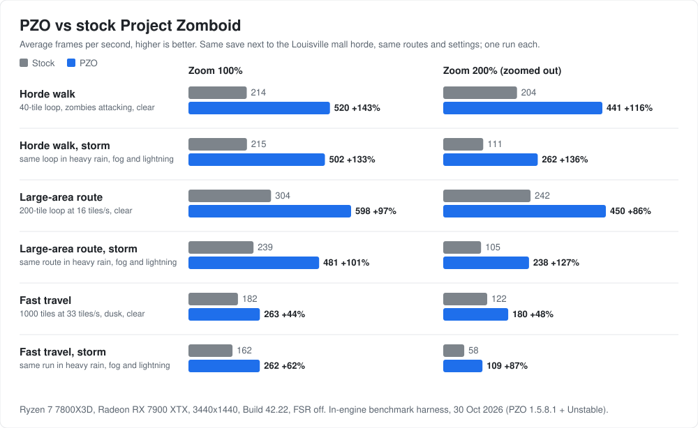

<div align="center">

# Multi-Threading for Project Zomboid is Here!

### Project Zomboid Optimizer (PZO)
**Parallel entity culling | AVX2 SIMD math | Zero-stutter chunk streaming**

</div>

---

A lightweight JVM runtime agent (`-javaagent`) and native AVX2 SIMD acceleration engine for **Project Zomboid (Build 42 & Build 41)** across **Windows, Linux / Steam Deck, macOS, and Dedicated Servers**.

Instead of replacing game classes on disk or relying on decompiled class overrides, PZO hooks the JVM at startup and patches game bytecode in memory to fix engine bottlenecks in rendering, chunk loading and horde updates. `projectzomboid.jar` and the game's own class files are never modified; the installer adds `PZOptimEngine.jar` and the native library to the game folder and updates the launcher JSON (`ProjectZomboid64.json`) so the game loads them.

| | |
|---|---|
| **Steam Workshop** | [Project Zomboid Optimiser (Item 3787481250)](https://steamcommunity.com/sharedfiles/filedetails/?id=3787481250) |
| **Wiki & Guides** | [Official PZO Wiki](https://github.com/prop11/PZO-Launcher/wiki) • [Manual Linux](https://github.com/prop11/PZO-Launcher/wiki/Manual-Linux-Installation) • [Zomdroid (Android)](https://github.com/prop11/PZO-Launcher/wiki/Zomdroid-Support-and-Installation) |
| **Releases** | [github.com/prop11/PZO-Launcher/releases](https://github.com/prop11/PZO-Launcher/releases) (`Install.bat`, `pzo_optimizer.sh`, `pzo_optimizer.command`, `PZOptimEngine.jar`) |
| **Supported Versions** | **Build 42 (all revisions) & Build 41.78+** on Windows 10/11, Linux (Proton & Native), Steam Deck, macOS, and Android (Zomdroid) |
| **Multiplayer** | In-memory bytecode instrumentation; the game's own class files and `projectzomboid.jar` are never modified. Dedicated server engine included. |

---

## Benchmarks



| Scenario | Zoom | Stock avg FPS | PZO avg FPS | Gain | 1% low FPS (stock -> PZO) |
|---|---|---|---|---|---|
| Horde walk (40-tile loop, zombies attacking, clear) | 100% | 214 | 520 | +143% | 36 -> 68 (+91%) |
| Horde walk (40-tile loop, zombies attacking, clear) | 200% | 204 | 441 | +116% | 60 -> 107 (+80%) |
| Horde walk, storm (same loop in heavy rain, fog and lightning) | 100% | 215 | 502 | +133% | 65 -> 123 (+89%) |
| Horde walk, storm (same loop in heavy rain, fog and lightning) | 200% | 111 | 262 | +136% | 43 -> 78 (+81%) |
| Large-area route (200-tile loop at 16 tiles/s, clear) | 100% | 304 | 598 | +97% | 44 -> 80 (+82%) |
| Large-area route (200-tile loop at 16 tiles/s, clear) | 200% | 242 | 450 | +86% | 59 -> 93 (+57%) |
| Large-area route, storm (same route in heavy rain, fog and lightning) | 100% | 239 | 481 | +101% | 62 -> 124 (+99%) |
| Large-area route, storm (same route in heavy rain, fog and lightning) | 200% | 105 | 238 | +127% | 39 -> 68 (+77%) |
| Fast travel (1000 tiles at 33 tiles/s, dusk, clear) | 100% | 182 | 263 | +44% | 22 -> 35 (+61%) |
| Fast travel (1000 tiles at 33 tiles/s, dusk, clear) | 200% | 122 | 180 | +48% | 26 -> 35 (+33%) |
| Fast travel, storm (same run in heavy rain, fog and lightning) | 100% | 162 | 262 | +62% | 35 -> 56 (+59%) |
| Fast travel, storm (same run in heavy rain, fog and lightning) | 200% | 58 | 109 | +87% | 18 -> 31 (+74%) |

Measured with PZO's in-engine benchmark harness: one launch of stock Project Zomboid and one with PZO, each running every scenario in turn on the same save next to the Louisville mall horde (zombies attacking throughout), first in clear weather and then in a forced storm (heavy rain, fog, wind and lightning), at zoom 100% and 200%. Ryzen 7 7800X3D, Radeon RX 7900 XTX, 3440x1440, Build 42.22, FSR off. Runs from 30 Oct 2026 on PZO 1.5.8.1 with the current Unstable changes; results will vary with hardware, mods and settings.

---

## Multi-Core Architecture

Stock Project Zomboid runs almost all spatial math, visibility calculations, and animation updates on a single thread. PZO offloads these calculations to a worker thread pool while keeping game state mutations thread-safe:

```
                              ┌──────────────────────────────────────────────┐
                              │      Dedicated P-Core Worker Thread Pool      │
                              │     (Pinned CPU Performance Core Affinity)    │
                              └──────┬──────────────┬──────────────┬─────────┘
                                     │              │              │
              ┌──────────────────────┴──────┐       │       ┌──────┴──────────────────────┐
              ▼                             ▼       ▼       ▼                             ▼
   ┌──────────────────────┐   ┌──────────────────────┐   ┌──────────────────────┐   ┌──────────────────────┐
   │       Pillar 1       │   │       Pillar 2       │   │       Pillar 3       │   │       Pillar 4       │
   │ MultiCoreChunkStream │   │ MultiCoreHordeGov    │   │ MultiCoreAnimation   │   │ MultiCoreIslandSched │
   │                      │   │                      │   │                      │   │                      │
   │ • 1MB Direct NIO Ring│   │ • AVX2 SIMD Partitions│   │ • 64-Bone Frustum    │   │ • 32x32 Spatial      │
   │ • Immediate Streamer │   │ • Frustum AABB Cull  │   │   Skinning Bypass    │   │   Island Buckets     │
   │   Queue Wake-Up      │   │ • Parallel FOV Cones │   │ • Distant 75% Frame  │   │ • Guaranteed Kahlua  │
   │ • Parallel Zlib Infl │   │ • Crowd Flocking Vec │   │   Skip Downsampling  │   │   Lua VM Safety      │
   └──────────────────────┘   └──────────────────────┘   └──────────────────────┘   └──────────────────────┘
```

### 1. Horde Simulation & Spatial Culling (`MultiCoreHordeGovernor`)
* **Partitioned Sweeps**: Active entities are partitioned into 256-zombie batches across CPU cores.
* **Native AVX2 Vector Math**: Evaluates entity distances, LOD tiers, camera frustum culling, 90° FOV awareness cones, and crowd repulsion steering vectors in compiled AVX2 SIMD assembly.
* **Lock-Free Snapshots**: Writes results to atomic snapshot arrays (`SNAPSHOT_DISTANCES`, `SNAPSHOT_TIERS`, `SNAPSHOT_MASK`, `SNAPSHOT_FOV`), giving the main thread instant reads without lock contention.

### 2. Skeletal Animation LOD (`MultiCoreAnimationEngine`)
* **Frustum Bone Bypass**: Skips all 64 bone matrix transformations for offscreen entities or entities culled outside the camera frustum.
* **Adaptive Frame Skipping**: Scales bone matrix updates for distant entities (>50 tiles away), cutting animation CPU overhead while maintaining full animation quality for nearby zombies.

### 3. Chunk Streamer Dispatch (`StreamerWake` & `MultiCoreChunkStreamer`)
* **Immediate Thread Dispatch**: Stock PZ throttles chunk requests on the game thread. PZO unparks and signals the background chunk streamer thread immediately upon enqueue.
* **Direct NIO Ring**: Allocates off-heap direct memory buffers for parallel chunk decompression, reducing driving stutter at high speeds.

---

## Render Optimizations

### High-Precision Timer & GC Tuning (`HighPrecisionTimer`)
* **Windows Multimedia Timer**: Sets the OS timer resolution to 1.0ms for consistent frame pacing and reduced micro-stutter.
* **Low-Latency GC Tuning**: Optimizes G1GC heap regions and background collection thresholds to prevent stop-the-world pauses during driving and combat.

---

## Installation

### Windows (1-Click)
1. Download **`PZO-Optimizer-Windows.zip`** from [GitHub Releases](https://github.com/prop11/PZO-Launcher/releases).
2. Extract the archive and double-click **`Install.bat`**.
3. Launch Project Zomboid normally through Steam.
*(To update or uninstall, simply run `Install.bat` again).*

### Linux & Steam Deck (SteamOS)
1. Download **`PZO_Optimizer_macOS_Linux.zip`** from [GitHub Releases](https://github.com/prop11/PZO-Launcher/releases).
2. Open a terminal in the extracted folder and run:
   ```bash
   chmod +x pzo_optimizer.sh && ./pzo_optimizer.sh
   ```
3. Launch Project Zomboid normally through Steam.
*(Prefer manual setup? See the [Manual Linux Installation Guide](https://github.com/prop11/PZO-Launcher/wiki/Manual-Linux-Installation)).*

### macOS (Apple Silicon & Intel)
1. Download **`PZO_Optimizer_macOS_Linux.zip`** from [GitHub Releases](https://github.com/prop11/PZO-Launcher/releases).
2. Double-click **`pzo_optimizer.command`** (or run `bash pzo_optimizer.sh` in Terminal).
3. Launch Project Zomboid normally through Steam.

### Android (Zomdroid)
Play Project Zomboid on mobile with native box64 translation:
* Follow the [Zomdroid Support & Installation Guide](https://github.com/prop11/PZO-Launcher/wiki/Zomdroid-Support-and-Installation) for instance preparation, Turnip driver selection, thermal throttling mitigations, and mobile RAM sizing (`-Xmx`).

---

## Dedicated Server Optimization (`PZOServerEngine.jar`)

Engineered for dedicated server nodes and 3rd-party game hosts (Indifferent Broccoli, G-Portal, Nitrado, GTXGaming, BisectHosting, Pterodactyl panels, Hetzner, OVH, Docker).

* **Low-Latency Networking**: Pools off-heap direct NIO buffers and expands UDP socket throughput to reduce desync during combat and driving.
* **Multi-Core Zombie Pathfinding**: Scales server-side AI migration across host CPU cores.
* **Asynchronous World Saves**: 256KB disk write buffering for SQLite `.db` tables (`players.db`, `vehicles.db`) and chunk saves, eliminating save-interval lag spikes.

### Dedicated Server Setup:
1. Upload **`PZOServerEngine.jar`** to your server's root directory via SFTP/FTP.
2. In `ProjectZomboid64.json`, keep `"mainClass": "zombie/network/GameServer"` and add `"-javaagent:PZOServerEngine.jar"` to `"vmArgs"`:
   ```json
   "vmArgs": [
       "-javaagent:PZOServerEngine.jar",
       "-Djava.awt.headless=true",
       "-Xmx8G",
       ...
   ]
   ```
3. Restart your server from your host control panel. See [`README_SERVER.md`](README_SERVER.md) for full details.

---

## In-Game Controls & Telemetry

When using the [PZO Steam Workshop Mod](https://steamcommunity.com/sharedfiles/filedetails/?id=3787481250), press **F10** in-game to open the **PZO Control Center** or **F9** for the live performance HUD:

* **Tab 7 ([+] JVM Engine)**: Live toggles for Quarter-Res Fog, Persistent VBOs, Multi-Core SIMD, and Background GC.
* **Live Telemetry HUD**: Monitors exact frame times, VRAM saved, persistent buffer memory, bone transforms bypassed, and chunk streamer latency in real time.

---

## Compatibility

* **Mod Compatibility**: 100% compatible with all standard Lua mods, vehicle packs, weapon overhauls, tilepacks, and custom maps.
* **ZombieBuddy Coexistence**: Fully compatible with **ZombieBuddy** (`zbNative`). PZO automatically detects and preserves `"-agentlib:zbNative"` in `ProjectZomboid64.json`.
* **For mod authors - PZOApi**: if your mod counts frames, drives zombies from Lua or keeps special corpses or items, a few lines with `PZOApi` tell PZO to leave it alone, without making PZO a requirement. See the [PZOApi reference](docs/MODDING_API.md).
* **Zomdroid (Android Mobile)**: Fully supported on ARM64 Android devices via [Zomdroid](https://github.com/udarmolota/zomdroid). The dedicated `zomdroid` branch resolves mobile OpenGL ES / GL4ES shader limits (including red models and vehicle texture units). See the [Zomdroid Support & Installation Guide](https://github.com/prop11/PZO-Launcher/wiki/Zomdroid-Support-and-Installation).

---

## Building from Source

### Requirements
* JDK 17+ (e.g. OpenJDK 17, 21, or 25)
* Python 3.8+ (for release packaging)

### Build Command
```bash
# Compile client and server classes
javac -d bin -cp bin -sourcepath "" $(find src -name "*.java")

# Package distribution JARs and release zip bundles
python3 package_release.py
```

---

## License
Source-available, all rights reserved. Versions up to and including V1.0.2.1 were released under GPL-3.0; every later version is covered by the [PZO Source-Available License](LICENSE), which prohibits redistribution, derivative works and any use of this project by AI systems.
