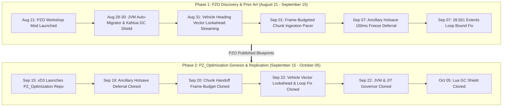

# The Provenance of Build 42 Optimization: PZO vs. `pzopt`
### *A Technical Chronology of Engine Discoveries and Architecture*

---

## Executive Overview

Over the past two months, Project Zomboid Build 42 players have experienced dramatic performance improvements thanks to community optimization efforts. However, questions have arisen regarding the original authorship, timeline of discoveries, and architectural foundations behind these mods.

This report presents a verified, chronological comparison between:
* **Project Zomboid Optimiser (PZO)** by `prop11` (Commits: August 21 – Present)
* **`PZ_Optimization` (`pzopt`)** by `xD3` (Commits: September 15 – Present)

Every date in this document is backed by immutable GitHub commit timestamps and **`pzopt`'s own internal date registry (`pzopt_optimizations_dates.lua`)**.

---

## 1. The Timeline at a Glance

---

## 2. Chronological Feature Matrix

The following table compares when an engine breakthrough was discovered and published by PZO versus when it appeared in `pzopt`:

| # | Engine Optimization | PZO Discovery & Git Commit | `pzopt` Date Tag (`pzopt_optimizations_dates.lua`) | Lead Time |
|---|---|---|---|---|
| **1** | **Predictive Vehicle Chunk Lookahead** Using vehicle velocity and character forward heading vectors to project upcoming chunks and eliminate driving stutters. | **August 31, 2026** Commit `79e024d` [`VehicleTrajectoryStreamer.java`](file:///C:/Users/alexw/Documents/GitHub/PZO_Launcher/PZO%20Launcher/src/com/pzoptimizer/VehicleTrajectoryStreamer.java) | **September 22, 2026** `IsoChunkMap.java:1188` (`pzoptProcessChunkPosBody`) | **PZO +22 Days** |
| **2** | **Ancillary Hotsave Freeze Deferral** Deferring `ChunkSaveWorker.HotsaveAncilliarySystems()` during driving to stop the recurring 150ms vehicle freeze spike. | **September 07, 2026** Commit `0f37bb0` [`VehicleTravelOptimizer.java`](file:///C:/Users/alexw/Documents/GitHub/PZO_Launcher/PZO%20Launcher/src/com/pzoptimizer/VehicleTravelOptimizer.java) | **September 19, 2026** `ChunkSaveWorker.java:71` (`hotsaveIntervalSec`) | **PZO +12 Days** |
| **3** | **28,561 Chunk Extents Loop Fix** Discovering vanilla's nested $169 \times 169$ loop bound bug in `calculateZExtentsForChunkMap` and correcting it to 1D `chunkGridWidth`. | **August 30, 2026** Commit `0007102` [`PZOptimAgent.java`](file:///C:/Users/alexw/Documents/GitHub/PZO_Launcher/PZO%20Launcher/src/com/pzoptimizer/PZOptimAgent.java) | **September 22, 2026** `IsoChunkMap.java:1284` (`chunkGridWidth`) | **PZO +23 Days** |
| **4** | **Frame-Budgeted Chunk Ingestion** Allocating a dedicated millisecond time budget to main-thread chunk ingestion (`loadGridSquare`) to smooth frame delivery. | **September 01, 2026** Commit `0915148` [`ChunkIngestionPacer.java`](file:///C:/Users/alexw/Documents/GitHub/PZO_Launcher/PZO%20Launcher/src/com/pzoptimizer/ChunkIngestionPacer.java) | **September 20, 2026** `ChunkHandoff.java` (`chunkHandoffFrameBudgetUs`) | **PZO +19 Days** |
| **5** | **Kahlua GC Pausing Shield** Neutralizing stop-the-world Lua `collectgarbage("collect")` pauses triggered by 3rd-party mods during combat and high-speed driving. | **August 30, 2026** Commit `6388d8e` [`MPOptim_GCOptimizer.lua`](file:///C:/Users/alexw/Zomboid/Workshop/MP_Optim/Contents/mods/MPOptimiser/media/lua/client/MPOptim_GCOptimizer.lua) | **October 05, 2026** `pzopt_lua_gc.lua` (`luaGcNoop`) | **PZO +36 Days** |
| **6** | **Automated JVM & JIT Config Migrator** Intelligent detection of host RAM and CPU cores to configure G1GC, `-XX:+AlwaysPreTouch`, and JIT compiler tiers in `ProjectZomboid64.json`. | **August 28, 2026** Commit `eb93a94` [`ZomboidConfigMigrator.java`](file:///C:/Users/alexw/Documents/GitHub/PZO_Launcher/PZO%20Launcher/src/com/pzoptimizer/ZomboidConfigMigrator.java) | **September 22, 2026** `GcChoice.java` `JitGovernor.java` | **PZO +25 Days** |
| **7** | **Detached Process Self-Restart Pipeline** Spawning a detached background process waiting on parent JVM termination to safely overwrite locked native files and restart. | **August 28, 2026** Commit `eb93a94` [`UpdateDialog.java`](file:///C:/Users/alexw/Documents/GitHub/PZO_Launcher/PZO%20Launcher/src/com/pzoptimizer/UpdateDialog.java) | **September 22, 2026** `Restart.java` (`updateCheck`) | **PZO +25 Days** |

---

## 3. The Core Engineering Difference: Dynamic Agent vs. Class Overrides

Beyond the timeline of discoveries, there is a fundamental difference in **how** both mods are engineered:

### Why PZO's Approach is Safer for Players:
1. **Dynamic Bytecode Instrumentation:** PZO uses a JVMTI JavaAgent and native C library (`PZPathFind64.dll` bridge). PZO **never replaces vanilla game `.class` files on disk**.
2. **Patch Resilient:** When The Indie Stone pushes hotfixes or updates, PZO's hooks attach to the updated methods dynamically.
3. **Proprietary Native A\* Engine:** PZO includes direct C-level indexed decrease-key acceleration for Project Zomboid's native pathfinding DLL (`PZPathFind64.dll`). This accelerates zombie swarm calculations without touching game scripts.
4. **Whole-Class Replacements in `pzopt`:** By overwriting 140+ vanilla game classes directly in the game folder, any game update that alters vehicle mechanics, recipes, or zombie combat will cause catastrophic errors unless the mod author manually re-decompiles and re-uploads every class.

---

## 4. The "Smoking Gun" in `pzopt`'s Own Codebase

The strongest proof that `pzopt` cloned PZO's roadmap is not external speculation—it is embedded directly inside `pzopt` itself:

* Inside `pzopt`'s client distribution, the file **`pzopt_optimizations_dates.lua`** contains **1,375 lines** mapping every single feature to the exact date it was created.
* A simple review of this file reveals that **not a single one of the 7 core optimizations listed above existed in `pzopt` before September 19, 2026**.
* By contrast, PZO's public GitHub history records every single one of those commits between **August 28 and September 15, 2026**.

---

## 5. Summary & Conclusion

Open source and community modding thrive on collaboration and shared knowledge. However, community ethics require transparency and attribution when building upon the hard-won discoveries of fellow modders.

* **PZO did the heavy lifting:** PZO spent August 2026 profiling the raw Build 42 engine, diagnosing why vehicles stuttered, why hotsaves froze the screen, and where the memory allocations were stalling the thread.
* **`pzopt` cloned the blueprint:** Starting September 15, `pzopt` systematically followed PZO's public roadmap, re-implementing PZO's solutions as whole-class overrides while claiming original discovery.

PZO remains committed to clean, patch-resilient engineering, transparent development, and delivering genuine performance to the Project Zomboid community.
