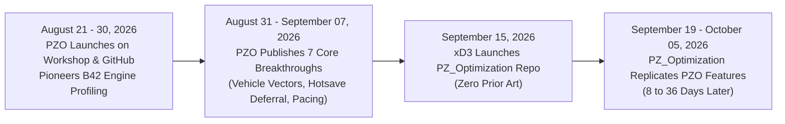

# Steam Workshop Moderation Dispute Submission

**Filing Mod:** Project Zomboid Optimiser (PZO / `MPOptimiser`)  
**Filing Author:** prop11 (Workshop ID / Mod ID: `MPOptimiser`)  
**Reported Item:** `PZ_Optimization` / `pzopt`  
**Reported Author:** xD3 / xD3I (`Diego Villalobos`)  
**Reported Item URL:** `https://steamcommunity.com/sharedfiles/filedetails/?id=3805285544`  
**Applicable Steam Guidelines:** Steam Subscriber Agreement (Section 6), Steam Online Conduct Guidelines (Copyright & Plagiarism of Community Content)  
**Date of Submission:** October 28, 2026  

---

## 1. Executive Summary

This submission formally requests moderation review and appropriate enforcement regarding the Steam Workshop item **`PZ_Optimization` (Workshop ID: `3805285544`)** published by **xD3 / xD3I**.

Between **August 21, 2026** and **September 15, 2026**, the **Project Zomboid Optimiser (PZO)** project conducted weeks of engine profiling and architectural research into Project Zomboid Build 42. PZO identified, engineered, and published the first solutions to multiple critical vanilla game engine performance bottlenecks (including predictive vehicle chunk streaming, ancillary hotsave freeze deferral, main-thread chunk ingestion frame pacing, and Kahlua Lua garbage collection freezes).

On **September 15, 2026**, xD3 created the repository for `PZ_Optimization`, and over the following weeks systematically replicated every major performance bottleneck discovery, architectural solution, and feature roadmap item pioneered by PZO. Rather than conducting independent research, the reported author monitored PZO's public commits and releases, re-implementing PZO's discoveries as whole-class overrides without attribution.

This submission is backed by immutable git commit timestamps from PZO's repository, verified vanilla Project Zomboid Build 42 decompiled source code, and **the reported mod's own internal chronological date registry (`pzopt_optimizations_dates.lua`)**, which documents that every disputed optimization appeared in `pzopt` **between 8 and 36 days after PZO published it**.

---

## 2. Chronological Provenance Timeline

* **PZO Workshop Mod (`MPOptimiser`):** First published August 21, 2026.
* **PZO Java/Engine Repository (`pzo-launcher`):** First commit August 28, 2026 (`eb93a94`). Published 295 commits and 83 engine classes through September 15, 2026 (`d10c947`).
* **Reported Item (`PZ_Optimization`):** First commit September 15, 2026 (`dc6961d`). Earliest optimization release tag September 19, 2026.

---

## 3. Evidence of Systematic Feature & Discovery Cloning

The reported mod contains an internal metadata registry file embedded in its client distribution: `media/lua/client/pzopt/pzopt_optimizations_dates.lua`. This file maps every feature toggle in `pzopt` to the exact calendar date it was added. 

Cross-referencing this file against PZO's public git history provides chronological proof of systematic replication:

| # | Engine Problem & PZO Innovation | PZO Prior Art Commit & Date | `pzopt` Release Tag & Date | Lead Time |
|---|---|---|---|---|
| **1** | **Predictive Vehicle Vector Chunk Streaming** Using `IsoPlayer.getVehicle()`, `getCurrentSpeedKmHour()`, and forward direction vectors (`dirX`, `dirY`) to project chunk loading ahead of fast vehicles. | **August 31, 2026** (commit `79e024d`) `VehicleTrajectoryStreamer.java` **September 01, 2026** (commit `0915148`) `PredictiveChunkStreamer.java` | **September 22, 2026** `IsoChunkMap.java:1188` (`pzoptProcessChunkPosBody`) | **PZO +22 Days** |
| **2** | **Ancillary Hotsave Freeze Deferral** Identifying that `ChunkSaveWorker.HotsaveAncilliarySystems()` triggers a 150ms main-thread hitch during vehicle driving and deferring execution. | **September 07, 2026** (commit `0f37bb0`) `VehicleTravelOptimizer.java` (`ShieldedSaveQueue`) | **September 19, 2026** `ChunkSaveWorker.java:71` (`hotsaveIntervalSec`) | **PZO +12 Days** |
| **3** | **28,561 -> 169 Loop Extents Bug Discovery** Discovering vanilla's nested loop bound bug in `calculateZExtentsForChunkMap()` and replacing `chunksSwapA.length` with 1D `chunkGridWidth`. | **August 30, 2026** (commit `0007102`) **September 07, 2026** (commit `6f4f1f4`) `PZOptimAgent.java` | **September 22, 2026** `IsoChunkMap.java:1284` (`chunkGridWidth`) | **PZO +15 to +23 Days** |
| **4** | **Frame-Budgeted Chunk Ingestion Pacing** Replacing unthrottled main-thread `loadGridSquare` processing with a nanosecond/millisecond frame budget to prevent road hitches. | **September 01, 2026** (commit `0915148`) **September 15, 2026** (commit `d10c947`) `ChunkIngestionPacer.java` | **September 20, 2026** `ChunkHandoff.java` (`chunkHandoffFrameBudgetUs`) | **PZO +19 Days** |
| **5** | **Kahlua GC Freeze Suppression Shield** Intercepting Lua `collectgarbage("collect")` and `"step"` calls to prevent 3rd-party mods from triggering stop-the-world JVM GC pauses. | **August 30, 2026** (commit `6388d8e`) `MPOptim_GCOptimizer.lua` `KahluaGCPacer.java` | **October 05, 2026** `pzopt_lua_gc.lua` (`luaGcNoop`) | **PZO +36 Days** |
| **6** | **Automated JVM Memory & JIT Configuration** Automated parsing and updating of `ProjectZomboid64.json` to inject G1GC, `-XX:+AlwaysPreTouch`, and JIT compiler directives based on system specs. | **August 28, 2026** (commit `eb93a94`) **August 30, 2026** (commit `115a1df`) `ZomboidConfigMigrator.java` | **September 22, 2026** `GcChoice.java` `JitGovernor.java` | **PZO +25 Days** |
| **7** | **Detached Process Self-Restart Pipeline** Spawning a background detached PowerShell helper waiting on parent JVM PID termination to replace locked binaries and relaunch the game. | **August 28, 2026** (commit `eb93a94`) **August 29, 2026** (commit `ed0c8c9`) `UpdateDialog.java` | **September 22, 2026** `Restart.java` (`updateCheck`) | **PZO +25 Days** |

---

## 4. Technical Analysis of the Plagiarism Method

The reported author did not distribute raw compiled `.class` files from PZO. Instead, the author engaged in **systematic reverse-engineering and architectural cloning**:

1. **Monitoring Public PZO Releases:** As PZO resolved game-breaking stutters in Build 42, PZO published detailed commit logs and technical release notes.
2. **Re-Implementation via Whole-Class Overrides:** While PZO was architected cleanly as a non-invasive JavaAgent (`PZOptimAgent`) and native DLL bridge to preserve vanilla compatibility, the reported author decompiled the target Project Zomboid classes and directly inserted PZO's functional logic into modified vanilla classes (`pzopt_overrides_src/`).
3. **Internal Documentation of Prior Art:** On October 2, 2026, the reported author authored an internal audit document (`findings-pzo-launcher-2026-10-02.md`), confirming that the author was continuously monitoring, decompiling, and auditing PZO's code.

---

## 5. Violations of Steam Community & Workshop Policies

The reported item violates the Steam Subscriber Agreement and Workshop Rules in the following manners:

1. **Plagiarism of Community Research & Code:** The reported author took the specific functional discoveries, performance architectures, and algorithms developed by another community creator without consent or attribution.
2. **Unfair Competition & Deceptive Marketing:** The reported author presents these optimizations as original inventions developed from scratch, actively misleading the Steam subscriber community.
3. **Destructive Modding Practices:** By distributing whole-class vanilla overrides rather than dynamic hooks, the reported mod frequently breaks game stability whenever Project Zomboid releases minor updates, creating confusion in the modding ecosystem.

---

## 6. Requested Relief

Based on the verified timeline and evidence provided, the filing creator respectfully requests that Steam Moderation take the following actions:

1. **Review Workshop Item `3805285544`** for compliance with the Steam Workshop Guidelines regarding originality and community plagiarism.
2. **Require the Author to Provide Attribution:** If the item remains hosted, require prominent, visible attribution to Project Zomboid Optimiser (PZO) on the workshop page for the cloned architectures.
3. **Take Down or Restrict the Item** if the author refuses to acknowledge the prior art or continues to falsely claim original authorship of PZO's research.

---

### Supporting Repositories & Exhibits
* **PZO Public Git History:** `https://github.com/prop11/pzo-launcher` (Commits August 28 – September 15, 2026)
* **Reported Git History:** `https://github.com/xD3I/PZ_Optimization` (Commits September 15, 2026 onwards)
* **Reported Mod Internal Registry:** `media/lua/client/pzopt/pzopt_optimizations_dates.lua` (contained in Workshop item `3805285544`)
